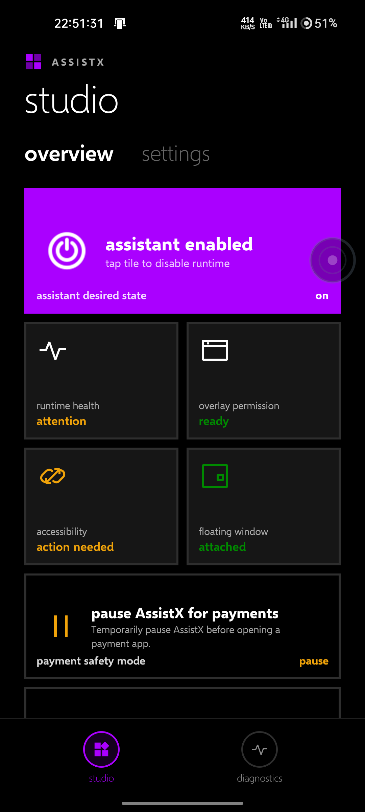
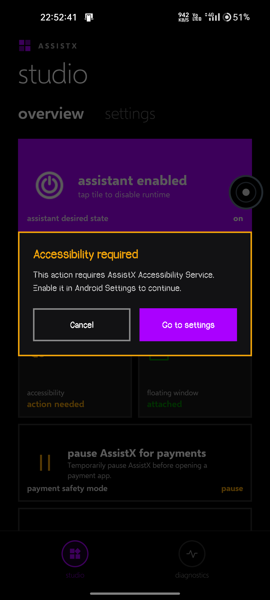
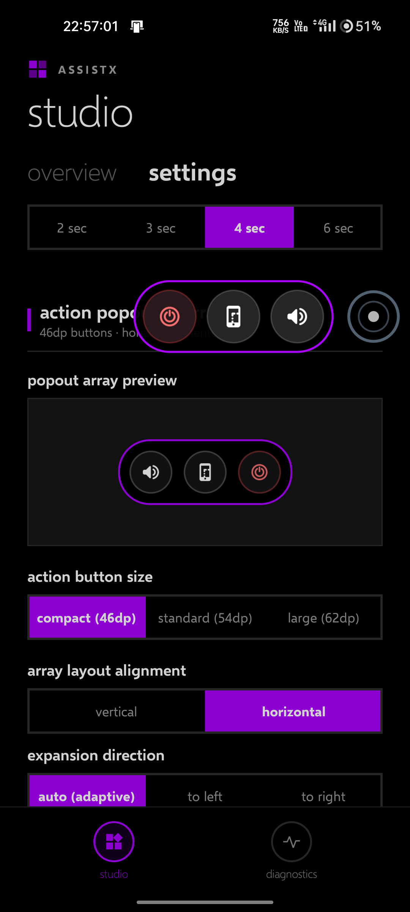
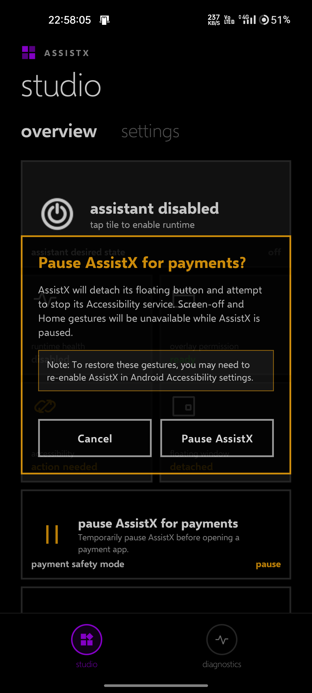
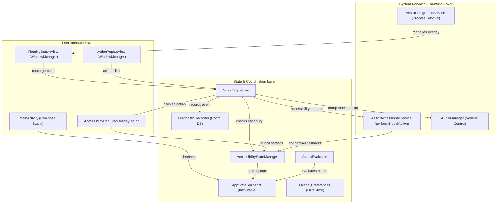

# AssistX

> **Reliability-first, privacy-conscious native Android assistive touch assistant.**

AssistX provides hardware key alternatives—such as double-tap screen lock, long-press home, native volume controls, system screenshot capture, and power dialog invocation—through an interactive floating button, backed by an in-app **Studio** dashboard with runtime diagnostics and a dedicated **Payment Safety Mode** for Indian UPI applications.

- **Current Release Status:** Release Candidate 2 (`v0.1.0-rc2`)
- **Primary Hardware Baseline:** Realme Narzo 30 4G (`RMX2156`, realme UI 3.0 / Android 12, API 31)

---

## 1. Features

### Verified Implemented Functionality

- **Interactive Floating Button (`FloatingButtonView`)**
  - Custom 56dp circular touch button drawn with low-allocation Canvas rendering.
  - Decelerating physics-based snap-to-edge animation on drag release.
  - Automatic 3-second idle fade to 40% opacity to prevent content obstruction.
  - Screen-off detachment and screen-wake re-attachment to optimize memory and battery.
  - Multi-orientation coordinate clamping and edge mirroring on screen rotation.
  - Persistent drag coordinates saved across app restarts via Jetpack DataStore.

- **Gesture Shortcuts & Action Dispatch**
  - **Double-Tap**: Instant Screen Lock via `GLOBAL_ACTION_LOCK_SCREEN` (<100ms response).
  - **Long-Press (500ms)**: Navigate Home via `GLOBAL_ACTION_HOME`.
  - **Tap**: Expand or collapse the customizable Action Popout array.

- **Configurable Action Popout Array (`ActionPopoutView`)**
  - **Volume Control**: Direct system volume slider adjustment via `AudioManager.FLAG_SHOW_UI` (runs independently without requiring accessibility).
  - **Screenshot**: Native display capture via `GLOBAL_ACTION_TAKE_SCREENSHOT` (API 28+).
  - **Power Menu**: System power dialog invocation via `GLOBAL_ACTION_POWER_DIALOG`.
  - Customizable alignment (horizontal or vertical), expansion direction (adaptive, left, right), button sizing (46dp, 54dp, 62dp), spacing, and optional background capsule styling.

- **Intelligent Action-Specific Accessibility Gating**
  - Actions that do not require accessibility (Volume controls, drag/reposition, popout toggle, edge snap, Studio settings, Payment Safety Mode) execute immediately without permission prompts.
  - Actions requiring accessibility (Screen Lock, Home, Screenshot, Power Dialog) automatically display a modal dialog if accessibility is disabled or disconnected.
  - **Zero-Replay Invariant**: When returning from system settings after enabling accessibility, the previously attempted action is **never automatically replayed**, preventing accidental screen locks or unintended navigation.

- **Payment Safety Mode (UPI Protection)**
  - Financial applications in India (such as BHIM, Google Pay, and PhonePe) restrict transactions or block access when third-party accessibility services or overlays are active.
  - AssistX provides a one-tap **Payment Safety Mode** that invokes `AccessibilityService.disableSelf()` and detaches the floating overlay from WindowManager.
  - Protected with a double-approval confirmation modal to prevent accidental accessibility revocation.

- **Metro / Modern UI Design Language**
  - Clean typographic hierarchy using Selawik font weights.
  - Flat 0dp sharp rectangular tiles with 2dp solid borders.
  - Contrast compliance: strictly enforces WCAG AA contrast (> 4.5:1 on normal text, > 10:1 on dark surfaces).
  - Stacked vertical status labels that eliminate word-breaking and awkward multiline wraps.
  - Elimination of decorative AI-style status dots and redundant pill badges.
  - Mandatory accordion collapse on every fresh entry to the Settings tab.

- **Subsystem Telemetry & Local Diagnostics (`DiagnosticsScreen`)**
  - Local-only Room SQLite database (`assistx_diagnostics.db`) tracking lifecycle, permission, overlay, and action dispatch events.
  - Strict 500-event FIFO pruning bounds memory use (< 2 MB).
  - Zero external network transmission, analytics, or third-party tracking.

### Experimental & Planned Features

- **Experimental:** None in current release scope.
- **Planned:**
  - Additional gesture assignment slots for Back and Recent Apps.
  - Split-screen multi-window shortcut.
  - OEM-specific autostart and battery optimization helper wizards.

---

## 2. Screenshots

Verified screenshots captured directly on physical hardware (Realme Narzo 30 4G, Android 12):

| Studio Overview (Metro UI) | Accessibility Required Modal |
|:---:|:---:|
|  |  |
| *Verified runtime health, accessibility state, and live tiles.* | *WindowManager modal shown only when gated action is attempted.* |

| Action Popout Menu | Payment Safety Mode Confirmation |
|:---:|:---:|
|  |  |
| *Horizontal action array with Volume, Screenshot, and Power.* | *Double confirmation before revoking accessibility for UPI safety.* |

---

## 3. Architecture

AssistX follows a clean, decoupled architecture centered around immutable state observation:



### Architectural Principles

1. **Separation of Intent from Observation**: The user's desired state (`ON`, `OFF`, `PAUSED`) is strictly separated from platform observations (`RuntimeState`, `OverlayPermissionState`, `AccessibilityState`).
2. **Least-Privileged Accessibility**: `AssistAccessibilityService` declares `canRetrieveWindowContent="false"` and `accessibilityEventTypes=""`. It cannot read on-screen text, inspect user inputs, or track running applications.
3. **Fail-Safe Overlay Lifecycle**: WindowManager operations are synchronized on a reentrant window lock. All child popouts and dialogs are dismissed whenever the primary overlay detaches.
4. **Bounded Local Telemetry**: All event logging is written to a local SQLite database with automatic FIFO pruning at 500 events.

---

## 4. Technology Stack

- **Language:** Kotlin `2.0.21` (JVM Target 17)
- **Build System:** Gradle `8.11.1` with Android Gradle Plugin `8.7.2`
- **UI Toolkit:** Jetpack Compose (BOM `2024.10.01`) + Material 3 `1.3.1`
- **Asynchronous Programming:** Kotlin Coroutines `1.9.0` + Kotlin Flow
- **Data Persistence:** AndroidX DataStore Preferences `1.1.1`
- **Local Database:** AndroidX Room `2.6.1` with KSP `2.0.21-1.0.28`
- **Architecture Components:** AndroidX Lifecycle Runtime & ViewModel Compose `2.8.7`
- **Testing:** JUnit `4.13.2`, Kotlin Coroutines Test `1.9.0`, AndroidX Test JUnit `1.2.1`

---

## 5. Requirements

- **JDK:** OpenJDK 17 or OpenJDK 21 (configured as `JAVA_HOME`)
- **Android SDK:**
  - `compileSdk = 35` (Android 15)
  - `targetSdk = 34` (Android 14)
  - `minSdk = 28` (Android 9.0 Pie)
- **Supported Devices:** Any physical Android device or emulator running Android 9.0 (API 28) or higher.
- **Physical Test Baseline:** Realme Narzo 30 4G (realme UI 3.0 / Android 12, Build `RMX2156_11_F.19`).

---

## 6. Getting Started

### 1. Clone Repository
```bash
git clone https://github.com/anujp125/AssistX.git
cd AssistX
```

### 2. Verify Environment
Ensure JDK 17+ and the Android SDK are configured:
```bash
java -version
```

### 3. Build Debug APK
```bash
# On Linux / macOS
./gradlew assembleDebug

# On Windows (PowerShell)
.\gradlew.bat assembleDebug
```

### 4. Install on Connected Device
```bash
adb devices
.\gradlew.bat installDebug
```

---

## 7. Permissions and First-Time Setup

Android security architecture requires explicit user approval for system-level overlays and accessibility services:

1. **Draw Over Other Apps (`SYSTEM_ALERT_WINDOW`)**
   - Required to display the floating button.
   - When launching AssistX for the first time, tap the **Overlay Permission** card in Studio. AssistX will open Android's *Display over other apps* settings screen. Toggle AssistX to **Allowed**.
2. **Accessibility Service (`BIND_ACCESSIBILITY_SERVICE`)**
   - Required for Screen Lock, Home, Screenshot, and Power Dialog actions.
   - Android prohibits applications from enabling accessibility programmatically.
   - Tap the **Accessibility** card in Studio to open Android's Accessibility settings. Locate **AssistX** under *Downloaded apps* and toggle it **On**.
3. **Notifications (`POST_NOTIFICATIONS`)**
   - Required on Android 13+ (API 33+) so that the foreground service can show a silent status notification, protecting AssistX from background memory reclamation.
4. **Haptic Feedback (`VIBRATE`)**
   - Used for subtle tactile clicks when touching or dragging the button.

### What Happens When Accessibility is Unavailable?
The floating assistant **does not break or crash**. Non-accessibility functions (Volume control, button repositioning, edge snapping, idle fade, Studio settings, Diagnostics) remain fully operational. If you attempt a gesture requiring accessibility, AssistX will show the **Accessibility required** dialog with a direct button to system settings.

---

## 8. Using AssistX

### Gesture Reference

| Gesture / Input | Target Action | Accessibility Required? |
|---|---|:---:|
| **Double-Tap** | Lock Screen | **Yes** |
| **Long-Press (500ms)** | Navigate Home | **Yes** |
| **Single Tap** | Toggle Action Popout Menu | **No** |
| **Drag & Release** | Reposition with Edge Snapping | **No** |
| **Popout: Volume** | Adjust system audio volume | **No** |
| **Popout: Screenshot** | Take full screen screenshot | **Yes** |
| **Popout: Power** | Open system power dialog | **Yes** |

### Studio Dashboard & Settings
- **Overview Tab:** Displays the master ON/OFF toggle, verified runtime health, subsystem statuses, and the Payment Safety Mode trigger.
- **Settings Tab:** Accordion-based configuration allowing users to customize:
  - Button size (compact 46dp, standard 54dp, large 62dp).
  - Popout orientation (horizontal or vertical) and expansion direction.
  - Button spacing and margin offsets.
  - Background capsule container style (obsidian, metro black, solid accent, outline only).
  - Haptic feedback and snap-to-edge toggles.
- **Diagnostics Tab:** Real-time system monitoring showing memory usage, window states, and a chronological event log with single-tap log clearing.

### Payment Safety Mode for UPI Applications
When opening financial apps (such as BHIM, Google Pay, or PhonePe):
1. In AssistX Studio, tap **pause AssistX for payments**.
2. Confirm the prompt on the double-approval modal.
3. AssistX will immediately detach the floating button and disable its accessibility service via Android's `disableSelf()` API.
4. Complete your UPI transaction safely without accessibility interception warnings.
5. When finished, re-enable AssistX in Android Accessibility settings.

---

## 9. Build Variants and Release

| Variant | Application ID | Debuggable | Minify | Purpose |
|---|---|:---:|:---:|---|
| **`debug`** | `com.nudge.assist.debug` | Yes | No | Local development and device debugging |
| **`release`** | `com.nudge.assist` | No | No | Distribution and production release candidate |

### Building Release Artifacts
```bash
# Build unsigned release candidate APK
.\gradlew.bat assembleRelease
```
Output location:
```text
app/build/outputs/apk/release/app-release-unsigned.apk
```

### Release Signing
To produce a signed release APK without checking secrets into Git, provide environment variables or local properties (see `keystore.properties.example`):
```bash
export RELEASE_KEYSTORE_FILE="/path/to/release.keystore"
export RELEASE_KEYSTORE_PASSWORD="your_keystore_password"
export RELEASE_KEY_ALIAS="your_key_alias"
export RELEASE_KEY_PASSWORD="your_key_password"

.\gradlew.bat assembleRelease
```
Or manually sign using Android SDK `apksigner`:
```bash
apksigner sign --ks release.keystore --out app-release-signed.apk app/build/outputs/apk/release/app-release-unsigned.apk
```

---

## 10. Testing

### Automated Test Suite
The repository includes 63 comprehensive unit tests covering state transitions, action gating, recovery limits, and touch coordinators:
```bash
.\gradlew.bat test
```
Test suites include:
- `ActionDispatcherTest`: Action classification, non-accessibility pass-through, accessibility gating, and zero-replay guarantee.
- `StatusEvaluatorTest`: Deterministic evaluation of composite application state.
- `RuntimeControllerTest`: Service lifecycle, process survival, and recovery backoff policy.
- `ActionExecutorTest`: Execution bounds and global action translation.
- `StudioViewModelTest`: StateFlow emission, settings persistence, and accordion state handling.

### Device-Level Verification
Manual and ADB-assisted hardware testing is performed using Android Debug Bridge:
```bash
# Tap floating button on device
adb -s <device_id> shell input tap 984 833

# Long press for Home action
adb -s <device_id> shell input swipe 984 833 984 833 800
```
Detailed test protocols are maintained in [`docs/testing/real_device_test.md`](docs/testing/real_device_test.md).

---

## 11. Troubleshooting

- **Floating button is not visible:**
  - Verify that **Draw over other apps** is enabled in Android Settings -> Apps -> Special app access.
  - Verify that the master switch in Studio is toggled to **ON**.
- **Gestures do not trigger Screen Lock or Home:**
  - Check the Studio Overview tab. If Accessibility displays **action needed**, tap it to re-enable AssistX in Android Settings.
- **AssistX disappears after closing Recent Apps:**
  - On devices with aggressive memory management (Realme UI, MIUI, ColorOS, OxygenOS):
    1. Lock AssistX in the Recent Apps switcher.
    2. Set App Battery Usage to **Unrestricted** (allow background activity).
    3. Enable **Auto-launch** in App Management settings.
- **Build fails with Java compilation error:**
  - Verify that JDK 17 or JDK 21 is installed and set as `JAVA_HOME`.

---

## 12. Privacy and Security

- **Zero Network Communication:** AssistX declares **no internet permission** (`android.permission.INTERNET`) in its manifest. It cannot send or receive data over the network.
- **Zero Content Inspection:** The accessibility service configuration explicitly disables window content inspection (`canRetrieveWindowContent="false"`) and declares empty event types (`accessibilityEventTypes=""`). It cannot inspect text, read passwords, or capture keystrokes.
- **Local Diagnostics:** All event logs are stored in a private Room SQLite database on device storage and can be completely wiped at any time via the Diagnostics tab.
- **No Absolute Guarantees:** Payment Safety Mode cleanly detaches the overlay and stops the accessibility service via official Android APIs. However, banking applications apply varying heuristic detection mechanisms that may evolve across bank versions.

---

## 13. Known Limitations

- **Accessibility Re-Enablement Requires System Settings:** Android security prohibits third-party applications from enabling accessibility services programmatically. After using Payment Safety Mode, the user must manually re-enable AssistX in Android Settings.
- **API 28 Minimum:** Native system screenshot capture (`GLOBAL_ACTION_TAKE_SCREENSHOT`) and screen lock (`GLOBAL_ACTION_LOCK_SCREEN`) require Android 9.0 (API 28) or higher.

---

## 14. Project Structure

```text
AssistX/
├── app/
│   ├── src/
│   │   ├── main/
│   │   │   ├── java/com/assistx/
│   │   │   │   ├── accessibility/         # AssistAction, ActionDispatcher, AccessibilityStateManager
│   │   │   │   ├── data/                  # DataStore preferences & Room SQLite diagnostics
│   │   │   │   ├── overlay/               # OverlayManager and window coordinator
│   │   │   │   ├── runtime/               # RuntimeController and recovery engine
│   │   │   │   ├── service/               # AssistForegroundService, AssistAccessibilityService
│   │   │   │   ├── state/                 # AppStateSnapshot, StatusEvaluator
│   │   │   │   └── ui/                    # StudioScreen, DiagnosticsScreen, FloatingButtonView, Popout
│   │   │   ├── res/                       # Drawables, layouts, fonts, themes
│   │   │   └── AndroidManifest.xml
│   │   └── test/                          # 63 automated unit test suites
│   ├── build.gradle.kts
│   └── proguard-rules.pro
├── docs/
│   ├── assets/screenshots/                # Verified hardware device screenshots
│   ├── ai_development/                    # Sprint plans, decisions, definition of done
│   ├── architecture/                      # Architecture ADRs, state models, platform constraints
│   ├── product/                           # SRS, MVP scope, requirements traceability
│   └── testing/                           # Acceptance tests, hardware test matrix
├── gradle/
│   ├── libs.versions.toml
│   └── wrapper/
├── build.gradle.kts
├── keystore.properties.example            # Release signing template (placeholders only)
├── changelog.md                           # Keep a Changelog format
├── license.md                             # GNU GPLv3
└── README.md
```

---

## 15. Contributing and License

- **License:** GNU General Public License v3.0 (GPLv3). See [`license.md`](license.md) for full terms.
- **Contributions:** Pull requests and issue reports are welcome. All contributions must adhere to the 0dp Metro design guidelines, least-privilege permissions, and pass the automated test suite.
